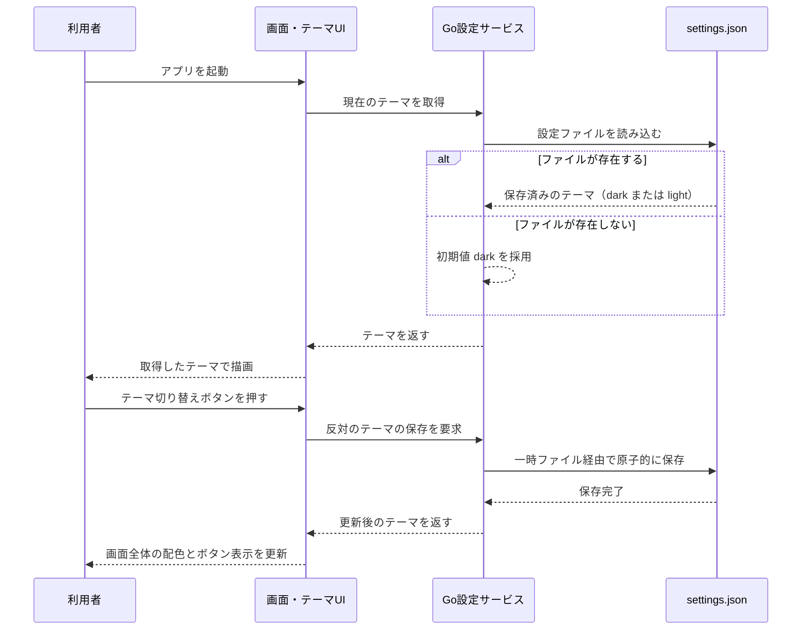

# UCP-4. 画面操作から Go サービス経由でアプリ設定を保存する

適用対象は [テーマを切り替える](../usecases/テーマを切り替える/README.md) である。Azure SDK や外部 API は呼ばず、Go サービスを通じてアプリのデータフォルダーに配置した設定ファイル（`settings.json`）の読み書きを行う。

## 責務と境界

| 役割 | 責務 | 実装パス |
| --- | --- | --- |
| テーマ基盤・連携 | 起動時に Go サービスから現在のテーマを取得して Mantine へ適用し、切り替え結果と失敗状態を管理する | `frontend/src/main.tsx`、`frontend/src/features/settings/queries.ts` |
| 切り替えUI | ヘッダー右側に切り替えボタンとツールチップを配置し、現在の配色に応じたアイコンと切り替え操作を提供する | `frontend/src/app/Shell.tsx`、`frontend/src/usecases/switch-theme/ThemeToggle.tsx` |
| スタイル・各画面 | 配色モードに追従するセマンティック変数を用いてライト・ダーク両対応の配色を描画する | `frontend/src/style.css`、`frontend/src/usecases/initial-deployments/AddDeploymentModal.tsx`、`frontend/src/usecases/initial-deployments/CreateFoundryProgressModal.tsx`、`frontend/src/usecases/initial-deployments/AcquisitionProgressModal.tsx` |
| Go サービス | `settings.json` の読み込み・検証・原子的保存と排他制御を行い、失敗時は公開エラーコード（`THEME_LOAD_FAILED` / `THEME_SAVE_FAILED`）を返す | `main.go`、`internal/settings/service.go` |

## 状態の確定とモック境界

状態更新の主体は Go 設定サービスであり、一時ファイルへの書き込みと置き換えによる保存が成功した時点でテーマ変更を確定する。保存失敗時は `THEME_SAVE_FAILED` を返し、画面のテーマと設定ファイルの内容は変更しない。起動時に `settings.json` が存在しない場合はエラーとせず初期値 `dark` を返す。ファイル読み込みまたは JSON 検証・値検証に失敗した場合は、画面操作を止めずに初期値 `dark` を表示しつつ `THEME_LOAD_FAILED` を通知する。保存形式と削除範囲は [データ設計](data.md#アプリ設定) に従う。

このパターンは外部通信を持たず、画面確認および E2E テストでも一時データフォルダー（`WAILS_DATA_DIR`）に対して Go サービスの実処理で設定ファイルを読み書きするため、専用のモック差し替え境界は設けない。
