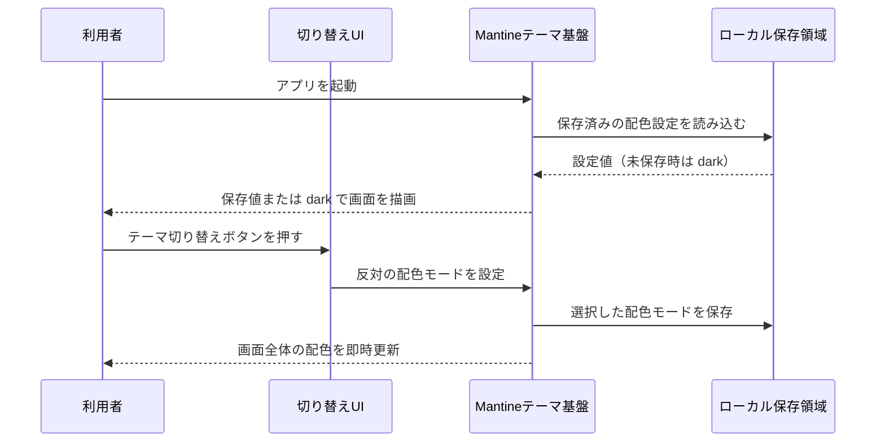

# UCP-4. フロントエンドで表示テーマを切り替えて保持する

適用対象は [テーマを切り替える](../usecases/テーマを切り替える/README.md) である。Go サービスや外部 API を呼ばず、フロントエンドの表示設定とブラウザーのローカル保存領域だけで完結する。

## 責務と境界

| 役割 | 責務 | 実装パス |
| --- | --- | --- |
| テーマ基盤 | Mantine の既定配色を `dark` として初期化し、ローカル保存領域からの復元と配色クラスの適用を行う | `frontend/src/main.tsx` |
| 切り替えUI | ヘッダー右側に切り替えボタンとツールチップを配置し、現在の配色に応じたアイコンと操作を提供する | `frontend/src/app/Shell.tsx`、`frontend/src/usecases/switch-theme/ThemeToggle.tsx` |
| スタイル・各画面 | 配色モードに追従するセマンティック変数（`--mantine-color-default*`、`--mantine-color-body` 等）を用いてライト・ダーク両対応の配色を描画する | `frontend/src/style.css`、`frontend/src/usecases/initial-deployments/AddDeploymentModal.tsx`、`frontend/src/usecases/initial-deployments/CreateFoundryProgressModal.tsx`、`frontend/src/usecases/initial-deployments/AcquisitionProgressModal.tsx` |

## 状態の確定とモック境界

状態更新の主体はフロントエンドの `MantineProvider` であり、切り替えボタンの押下時に `setColorScheme` で即座に配色を確定してローカル保存領域へ書き込む。保存領域への読み書きが制限された環境でも、メモリ上のテーマ切り替えは継続して動作する。

このパターンは外部システムやバックエンド通信を持たないため、専用のモック境界は設けず、既存の画面確認用構成（`server:review` 等）の上でログイン前モーダルと Home画面・各モーダルのライト／ダーク表示を確認する。
